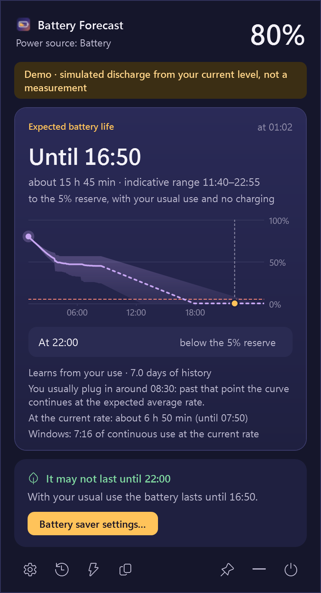
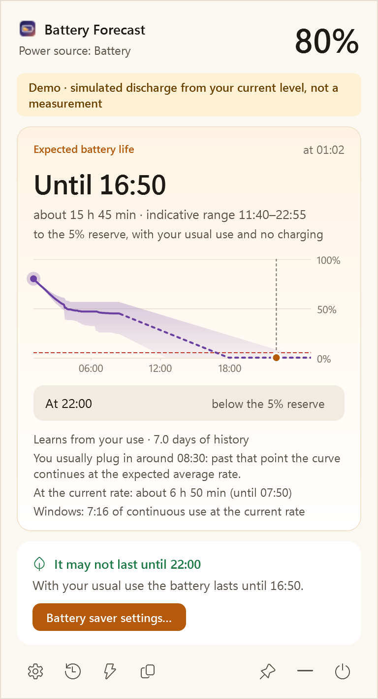
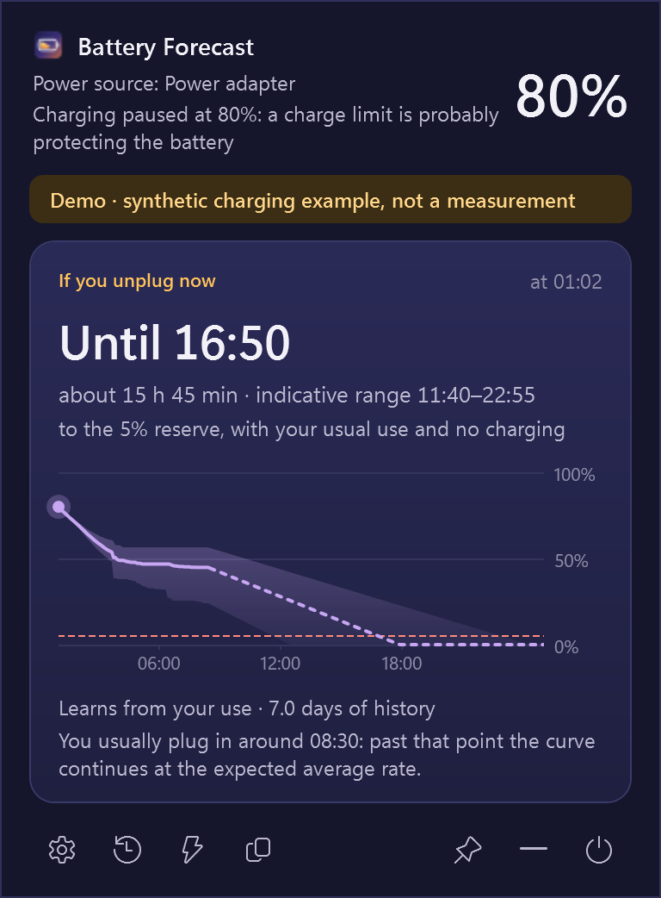
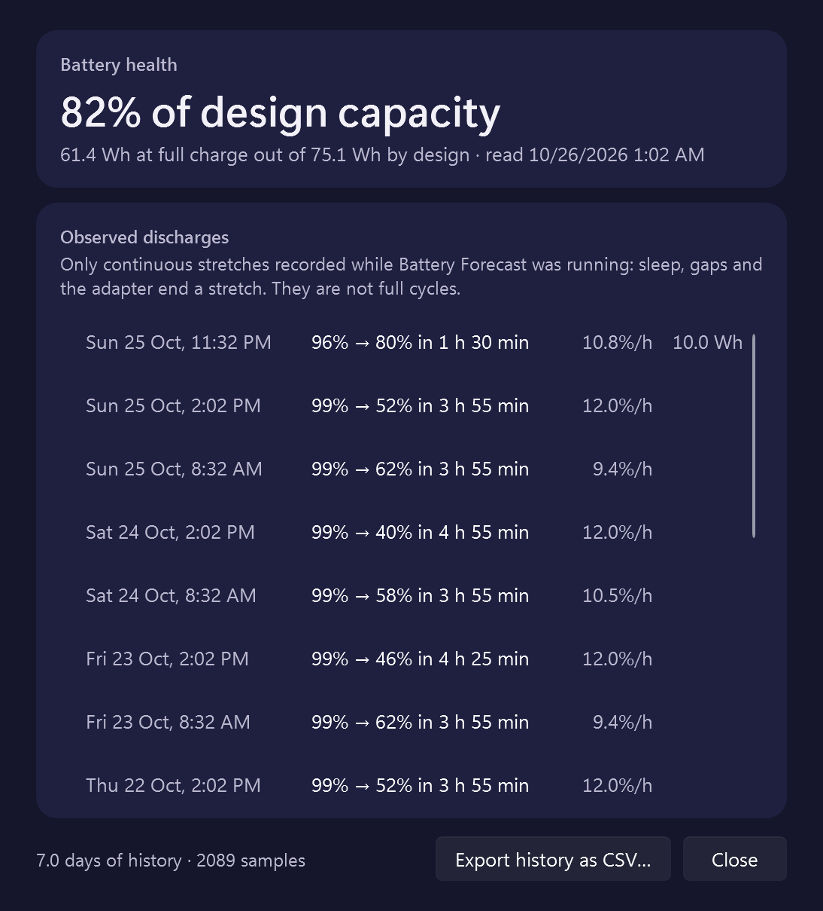
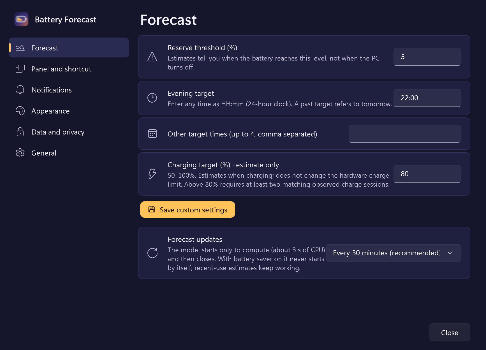

<p align="center">
  
</p>

<h1 align="center">Battery Forecast</h1>

<p align="center">
  <b>How long will your Windows laptop really last today?</b><br>
  An AI battery forecast that learns how you use your PC, and runs entirely on it.<br>
  <sub>Powered by <a href="https://github.com/mistralai/timestral">Timestral</a> · a Windows fork of <a href="https://github.com/mattBonfanti/till-dusk">Till Dusk</a></sub>
</p>

<p align="center">
  <a href="https://mattboxx.github.io/battery-forecast/"><b>Website</b></a> ·
  <a href="https://github.com/Mattboxx/battery-forecast/releases"><b>Download</b></a> ·
  <a href="docs/README.it.md">Italiano</a> ·
  <a href="https://ko-fi.com/mattboxx">♥ Support on Ko-fi</a>
</p>

<p align="center">
  
  
  <a href="https://github.com/Mattboxx/battery-forecast/releases"></a>
  <a href="LICENSE"></a>
  <a href="https://ko-fi.com/mattboxx"></a>
</p>

<p align="center">
  
  &nbsp;&nbsp;
  
</p>
<p align="center"><sub>Demo mode: the discharge in these screenshots is simulated from a real battery level.</sub></p>

> **Preview.** Battery Forecast works and is being tested on real laptops. Its accuracy has not been measured
> yet, so it does not claim any: it shows a range and tells you where each number comes from.

## What it does

Windows shows a percentage. Battery Forecast tells you what that percentage means for the rest of your day.

- **Until when.** The time your battery reaches the reserve (5% by default), with an indicative range from
  cautious to optimistic. Never a fake exact number: estimated times are rounded to 5 minutes.
- **Your evening.** The level expected at 22:00 or at any time you choose, and a suggestion to turn on battery
  saver when it would not last.
- **24-hour chart.** Central estimate, cautious/optimistic band, reserve line and your evening target.
- **Plugged in, too.** While charging: when you will reach your charge target (80% by default), learned by
  Timestral from your past charges. When the charge is held by a charge limit (or the battery is full): how
  long it would last if you unplugged now, with the same chart.
- **Habits and the present, side by side.** The forecast from your habits always comes with the estimate at your
  current rate and with Windows' own.
- **Calm alerts.** About 60, 30 and 15 minutes before the reserve, at low battery, when charged, and when the PC
  suddenly uses twice as much power. One alert per threshold per discharge, never on the adapter.
- **History and health.** Observed discharges and full-charge capacity vs design capacity, with source and date.
- **At home next to the clock.** Tray icon with the exact level, four themes (Dawn, Mist, Dusk, Midnight) or
  Windows' own, Italian and English, keyboard and screen-reader friendly.
- **Updates from the app.** One click checks GitHub, downloads the installer and verifies its SHA-256.

<p align="center">
  
  &nbsp;
  
</p>
<p align="center">
  
</p>

## How it works

```
Windows battery API ──► local history (SQLite, 1 sample/min) ──► Timestral (local, CPU) ──► 24-hour forecast
        │                                                                 ▲
        └──────────────► estimate at the current rate ────────────────────┴──► panel, tray, alerts
```

1. While it runs, Battery Forecast records your battery level and power source every minute, plus sleep, resume
   and charger events. Gaps stay gaps: nothing is invented for the time the PC was off.
2. [Timestral](https://github.com/mistralai/timestral), a time-series model by Mistral AI, reads up to 110 days of
   that history on a 5-minute grid and forecasts the next 24 hours, with percentiles.
3. The scenario is always the same, so the answer is clear: *your usual use, without plugging in from now on*.
   The curve can never rise and never goes above the current level.
4. When your habits say you usually plug in at a certain time, the model cannot know what you would use on
   battery. The panel says so and the chart continues at the expected average rate, drawn dashed.
5. Until there is enough history (a couple of hours of discharges), the estimate at your current rate is shown
   instead, and the panel says that too.

The details, limits and the meaning of the range are in the [model card](docs/MODEL_CARD.md).

## Light on your battery

The AI is not a background service. It starts, computes, and closes.

| | |
| --- | --- |
| Background forecasts on battery | at most every 30 minutes (or only when you open the panel, or every 10 minutes) |
| With battery saver on | the model never starts by itself |
| Cost of one forecast | about 3 s of CPU, measured on the development laptop |
| Between forecasts | no engine process, no CPU: it closes one minute after answering |

## Privacy

- No account, no telemetry. Battery history stays in `%LOCALAPPDATA%\BatteryForecast`; you can export it as CSV
  or delete it from Preferences.
- Forecasts work offline: Python, PyTorch and the model weights are inside the installer.
- The only network request is the optional daily update check to `api.github.com` (you can turn it off).
  Installers are downloaded only from GitHub and kept only if they match the published SHA-256.

## Install

1. Download `BatteryForecast-Setup-<version>-x64.exe` (Intel/AMD) or `-arm64.exe` (Snapdragon and other ARM PCs)
   from [Releases](https://github.com/Mattboxx/battery-forecast/releases).
2. Optional: check the file against the `.sha256` next to it:
   ```powershell
   Get-FileHash .\BatteryForecast-Setup-*.exe
   ```
3. Run it. It installs for your user only, without administrator rights. The preview is **not digitally signed**,
   so SmartScreen may warn you: choose *More info → Run anyway*.
4. The battery icon appears next to the clock. If Windows hides it, drag it out of the `^` overflow area.

Requirements: Windows 10 2004 or Windows 11, x64 or ARM64, about 280 MB download (800 MB installed, mostly PyTorch).
Uninstall from *Settings → Apps*; you will be asked whether to keep your battery history.

## Build from source

You need Windows x64, the .NET 10 SDK, Python 3.12 and [Inno Setup 6](https://jrsoftware.org/isinfo.php).

```powershell
# engine environment (CPU wheels) and model weights at the pinned revision
py -3.12 -m venv forecast\.venv
forecast\.venv\Scripts\python -m pip install -r forecast\requirements.lock --extra-index-url https://download.pytorch.org/whl/cpu
forecast\.venv\Scripts\python -m pip install pyinstaller pytest
forecast\.venv\Scripts\python tools\fetch_model.py --model 28M

# tests
dotnet test windows\tests\BatteryForecast.Tests
forecast\.venv\Scripts\python -m pytest -q forecast

# run from source (demo mode: simulated discharge, separate data folder)
dotnet run --project windows\src\BatteryForecast.App -- --demo

# full offline package and installer in artifacts\
powershell -NoProfile -File tools\package.ps1 -Version 0.9.0-alpha.2
```

ARM64 installers are built natively on Windows ARM by the [release workflow](.github/workflows/release.yml),
because PyInstaller packages the Python it runs on.

| Folder | What is inside |
| --- | --- |
| `windows/src/BatteryForecast.Core` | battery readings, history, forecast coordination, alerts, texts, updates |
| `windows/src/BatteryForecast.App` | WPF tray app, panel, chart, preferences, history window |
| `forecast/` | local Timestral engine (Python), JSON Lines protocol over stdin/stdout |
| `tools/` | packaging, icons, themes, texts, licenses |
| `site/` | the website, published with GitHub Pages |

## Credits and licenses

- **Battery Forecast** is a fork of **[Till Dusk](https://github.com/mattBonfanti/till-dusk) by Matteo Bonfanti**,
  the original macOS menu-bar app, released under the MIT license. The idea, the forecast approach and the
  wording of many messages come from it.
- **[Timestral](https://github.com/mistralai/timestral)** by Mistral AI: code under Apache 2.0, Timestral-28M weights
  under a modified MIT license (its exact text is in [`licenses/`](licenses) and inside the installer; it includes a
  condition for companies above a monthly revenue threshold). Battery Forecast is not affiliated with Mistral AI.
- Python, PyTorch, NumPy, .NET and the other bundled components keep their own licenses; the installer ships every
  text in its `licenses` folder.
- Battery Forecast's own code is MIT, see [LICENSE](LICENSE).

## Support

If Battery Forecast is useful to you, you can support its development on **[Ko-fi](https://ko-fi.com/mattboxx)**.
Bug reports and ideas are welcome in [Issues](https://github.com/Mattboxx/battery-forecast/issues).

## Preview alpha.2: more control and context

- **Explore the chart:** hover to move the dot along the forecast; read the local date/time, expected
  battery percentage and indicative range. Focus it and use Left/Right, Home or End from the keyboard.
  The tooltip identifies extrapolated portions; it does not claim calibrated confidence.
- **Set any time:** enter the main target and up to four additional targets as `HH:mm`, including
  overnight targets. A past time explicitly refers to tomorrow. Save custom settings with the button
  or Enter. Reserve percentages and alert minute thresholds are also editable.
- **Open it instantly:** a global shortcut (initially `Ctrl+Alt+B`) opens the panel and, pressed again, closes it.
  To change it, click *Change* in Preferences and press the keys: Ctrl, Alt or Win with a letter, digit, F key
  (except F12), Space, arrows or the numeric keypad. If Windows or another app already uses it, the previous one is kept.
- **Open on hover (optional):** rest the pointer on the tray icon and the panel opens without a click, without
  stealing focus, and closes when the pointer moves away; a click keeps it open.
- **Your size:** scale (80–160%) and width of the panel, applied as you move the sliders.
- **Charging forecast, too:** choose a target from 50–100% (default 80%). While charging, Timestral learns from
  your past charges and forecasts when you will reach it, with the same range, chart and honesty as the discharge
  forecast, including the slowdown near full. The current charging rate is shown next to it as a comparison and
  used alone until enough charges are recorded. It does not control a hardware charge limit.
- **Give the local model more context:** optionally collect aggregate CPU load/frequency, memory, battery
  charge/discharge watts, brightness, power profile and temperatures exposed by the device. Timestral
  receives eligible historical sensor channels; the panel names those actually used. Missing sensors stay
  unavailable. CPU temperature needs a compatible provider already installed; an ACPI zone is labelled separately.
  No driver, administrator helper, process names, online telemetry or future sensor values are introduced.
- **Make it yours:** quiet notification hours, custom alert thresholds, chart visibility and a persistent
  keep-open preference. Copy a battery summary, export battery/system-context CSV files, or create an
  explicit local diagnostic ZIP that excludes history and logs and is never uploaded automatically.

Charging and extra sensor context are experimental. The functional tests exercise the real local model,
but **an accuracy improvement has not been measured**. See [MODEL_CARD](docs/MODEL_CARD.md) for methodology
and limitations. Collection/model use can be disabled independently in Preferences.

The Windows package contains third-party components under their own terms. In particular, the Timestral
weights' Modified MIT license restricts exercising its rights when the global consolidated monthly
revenue of your company **or employer** exceeds USD 20 million (or equivalent) **for the preceding month**;
the full original text also addresses derivatives and combined works. This is not standard MIT.
Read the [original terms](licenses/vendor/Timestral-28M-LICENSE.txt) and [distribution audit](docs/LICENSE_AUDIT.md).
The MIT license applies to project code for which the contributors hold the relevant rights.

Battery Forecast is an independent adaptation and is not an official or endorsed product of Matteo
Bonfanti or Mistral AI. Donations to Mattboxx on Ko-fi fund this Windows port; they are not donations
to the original authors. Their copyright and attribution notices are preserved in every package.
