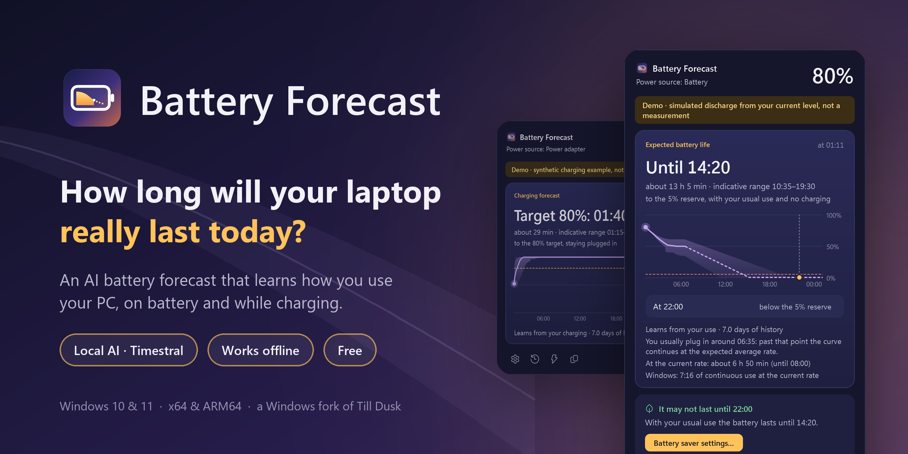
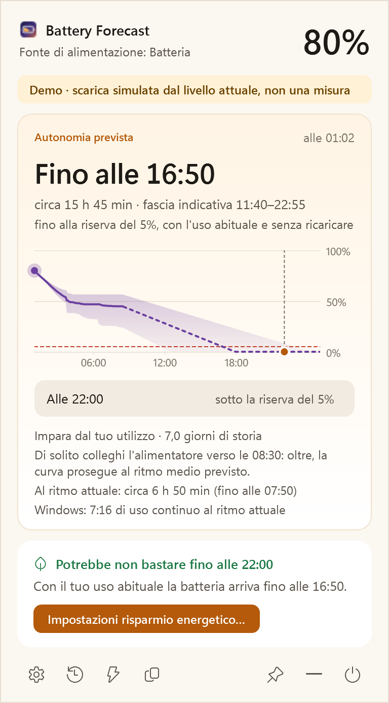
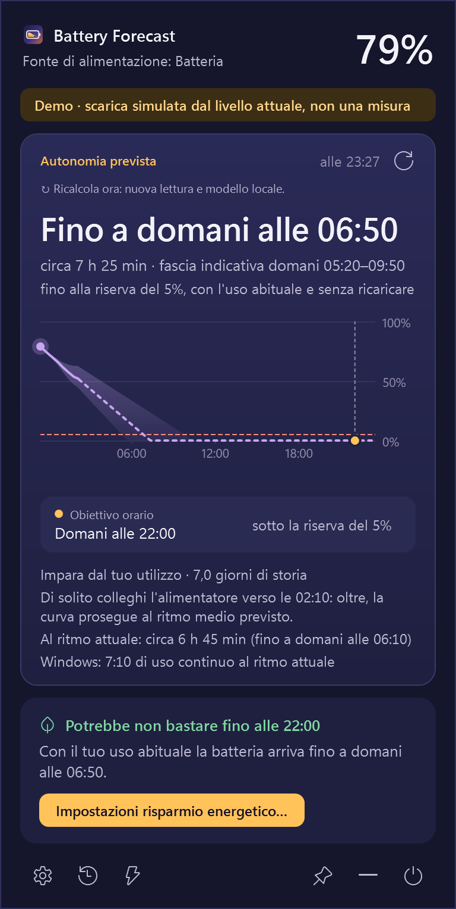
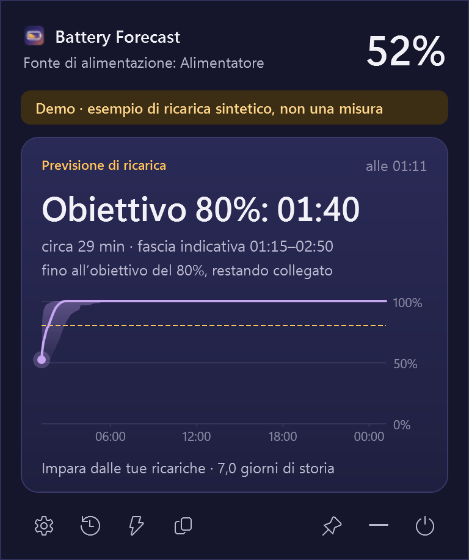
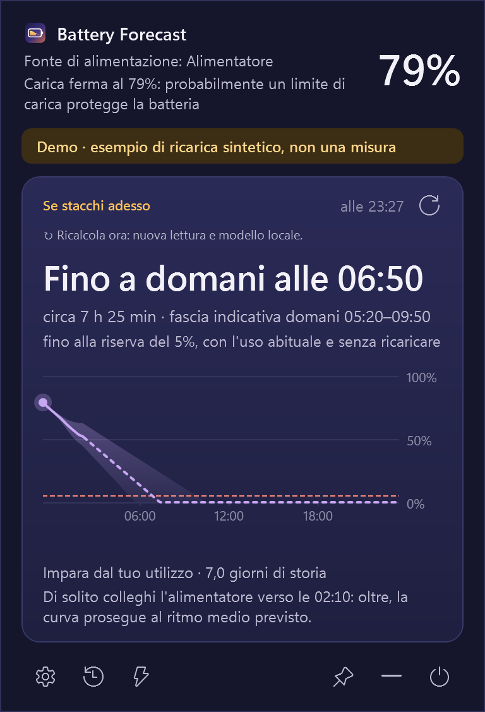
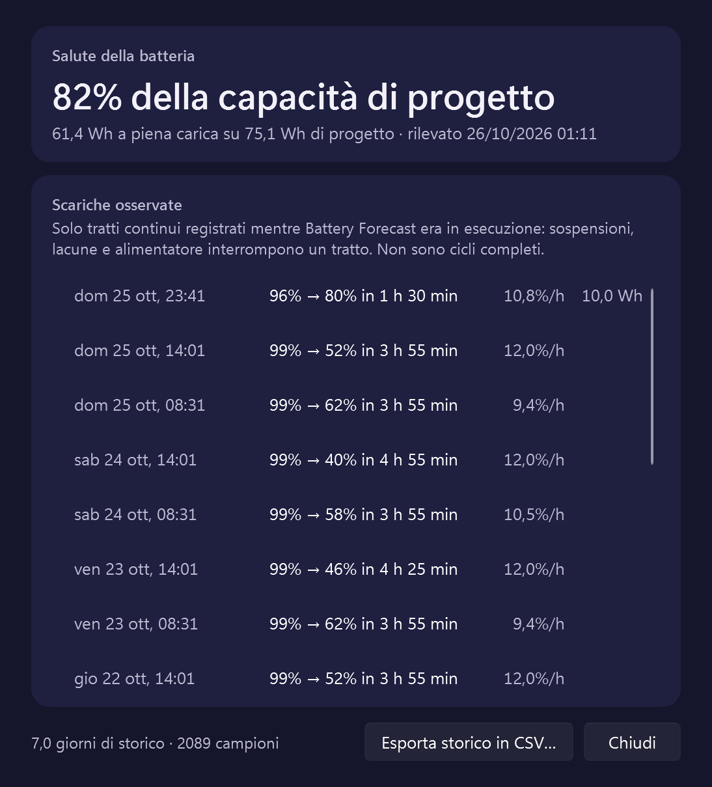
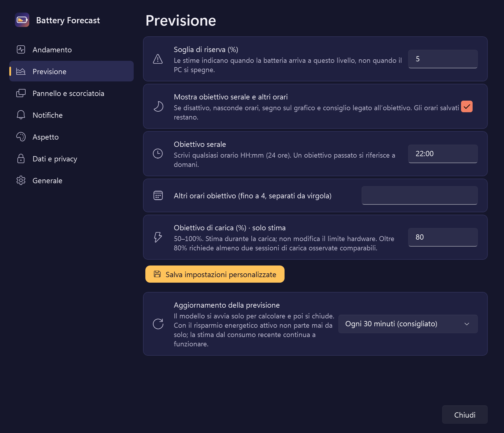
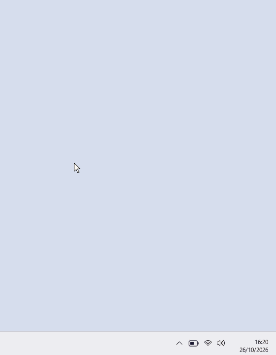
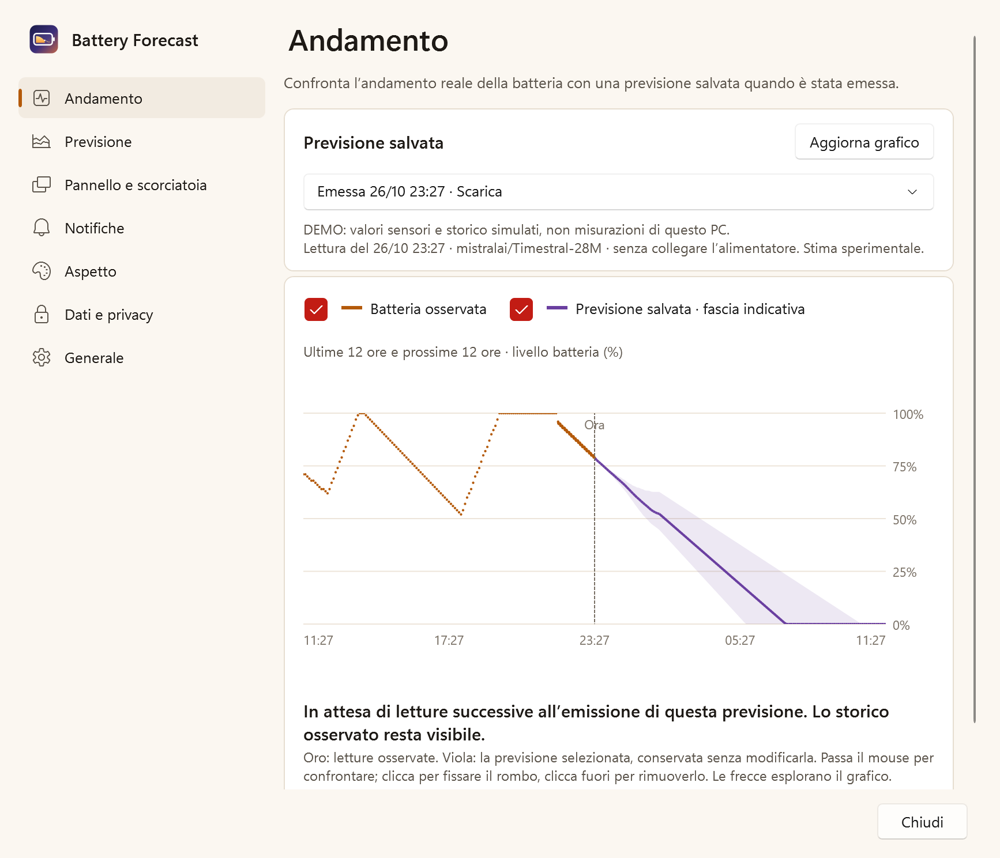

  

<h1 align="center">Battery Forecast</h1>

  <b>Quanto durerà davvero oggi la batteria del tuo portatile Windows?</b> 
  Una previsione con l'intelligenza artificiale che impara come usi il PC, e gira tutta sul PC. 
  Con <a href="https://github.com/mistralai/timestral">Timestral</a> · fork per Windows di <a href="https://github.com/mattBonfanti/till-dusk">Till Dusk</a>

  <a href="https://mattboxx.github.io/battery-forecast/"><b>Sito</b></a> ·
  <a href="https://github.com/Mattboxx/battery-forecast/releases"><b>Download</b></a> ·
  <a href="../README.md">English</a> ·
  <a href="https://github.com/sponsors/Mattboxx">♥ GitHub Sponsors</a> ·
  <a href="https://ko-fi.com/mattboxx">Ko-fi</a>

  <picture>
    <source srcset="images/it-panel-dark.png" media="(prefers-color-scheme: dark)">
    
  </picture>

Interfaccia demo · storico sintetico; previsioni calcolate dal vero modello locale.

> **Accuratezza delle previsioni.** Battery Forecast funziona ed è in prova su portatili reali. La sua accuratezza non è ancora stata
> misurata, quindi non ne dichiara: mostra una fascia e dice da dove viene ogni numero.

## Due previsioni, un pannello

Windows mostra una percentuale. Battery Forecast ti dice cosa significa per il resto della giornata, a batteria e
con l'alimentatore. Entrambe le previsioni vengono dallo stesso modello di intelligenza artificiale locale, che
legge come contesto il tuo storico della batteria: nulla viene caricato in rete e il modello non viene riaddestrato.

<table>
  <tr>
    <td align="center" width="33%"></td>
    <td align="center" width="33%"></td>
    <td align="center" width="33%"></td>
  </tr>
  <tr>
    <td valign="top"><b>A batteria: fino a quando.</b> L'ora in cui arrivi alla riserva (5% di default), con una
      fascia dalla stima prudente a quella ottimista, il livello previsto alla tua ora serale e il grafico delle 24 ore.</td>
    <td valign="top"><b>In carica: quando arrivi all'obiettivo.</b> Quando arriverai all'80% (o all'obiettivo che
      scegli), imparato dalle tue ricariche passate, compreso il rallentamento vicino al pieno, accanto al ritmo attuale.</td>
    <td valign="top"><b>Collegato, carica ferma.</b> Con un limite di carica (come la protezione all'80% di molti
      portatili) o a batteria piena: quanto dureresti staccando adesso, con lo stesso grafico.</td>
  </tr>
</table>

Modalità demo: storico sintetico; le previsioni sono calcolate dal vero modello locale.

- **Mai un numero finto preciso:** orari arrotondati a 5 minuti, sempre con una fascia e la loro fonte: le tue
  abitudini, il ritmo attuale e la stima di Windows, fianco a fianco.
- **La tua sera:** il livello previsto alle 22:00 o all'ora che scegli (più altri quattro orari), e il suggerimento
  del risparmio energetico quando non basterebbe.
- **Avvisi discreti:** a circa 60, 30 e 15 minuti dalla riserva, a batteria bassa, a carica raggiunta e con un
  consumo insolito. Un avviso per soglia in ogni scarica, mai con l'alimentatore. Orario silenzioso.
- **Sempre a portata di mano:** passa sull'icona, cliccala o premi la scorciatoia che registri (inizialmente
  `Ctrl+Alt+B`, premuta di nuovo chiude). Dimensione e larghezza del pannello a scelta.
- **Storico e salute:** le scariche osservate e la capacità a piena carica rispetto a quella di progetto.
- **Vicino all'orologio:** icona con il livello esatto, quattro temi (Alba, Nebbia, Crepuscolo, Notte) o quello
  di Windows, italiano e inglese, tastiera e lettori di schermo.
- **Aggiornamenti dall'app:** un clic controlla GitHub, scarica l'installer e ne verifica lo SHA-256.

  
  &nbsp;
  

## Un’occhiata dall’area di notifica

<table>
  <tr>
    <td width="55%" valign="middle">
      
La previsione resta accanto all’orologio. Aprila quando ti serve, poi torna a quello che stavi facendo.

      <ul>
        <li><b>Passa sull’icona</b> della batteria per aprire il pannello.</li>
        <li><b>Allontanati</b> per richiuderlo; clicca per tenerlo aperto.</li>
        <li><b>Usa la tastiera</b> con la tua scorciatoia: premila di nuovo per chiudere.</li>
      </ul>
    </td>
    <td width="45%" align="center">
      <picture>
        <source srcset="images/it-hover-open-dark.gif" media="(prefers-color-scheme: dark)">
        
      </picture>
    </td>
  </tr>
</table>

Anteprima dell’apertura al passaggio · demo con storico simulato.

## Come funziona

1. Mentre è aperta, l'app registra ogni minuto livello e alimentazione, più sospensioni, riprese e alimentatore.
   Le lacune restano lacune: per il tempo a PC spento non si inventa nulla.
2. [Timestral](https://github.com/mistralai/timestral), un modello di Mistral AI per le serie temporali, legge
   fino a 110 giorni di storico su una griglia di 5 minuti e prevede le prossime 24 ore.
3. Ogni previsione risponde a uno scenario chiaro. A batteria, o collegato con la carica ferma: *uso abituale,
   senza collegare l'alimentatore da adesso*, quindi la curva non risale. In carica: *resto collegato*, quindi la
   curva non scende e si ferma al 100%. Lo scenario arriva al modello come dato futuro noto.
4. Quando di solito colleghi (o stacchi) l'alimentatore a una certa ora, il modello non può sapere cosa
   succederebbe dopo: il pannello lo dice e il grafico prosegue, tratteggiato, al ritmo medio previsto.
5. Finché lo storico non basta (qualche ora di scariche o alcune ricariche), si mostra la stima al ritmo attuale,
   e il pannello lo dice.

Dettagli e limiti nella [model card](MODEL_CARD.md) (in inglese).

## Leggera sulla batteria

Il modello non resta in esecuzione: si avvia, calcola e si chiude. In background a batteria parte al massimo
ogni 30 minuti (oppure solo quando apri il pannello, o ogni 10 minuti), mai con il risparmio energetico attivo.
Una previsione costa circa 3 secondi di CPU sul portatile di sviluppo; fra una previsione e l'altra non resta
nessun processo del motore.

## Privacy

Nessun account, nessuna telemetria: lo storico resta in `%LOCALAPPDATA%\BatteryForecast` e si può esportare o
cancellare dalle Preferenze. Le previsioni funzionano senza rete. L'unica richiesta di rete è il controllo
giornaliero facoltativo degli aggiornamenti su `api.github.com`.

## Installazione

1. Scarica `BatteryForecast-Setup-<versione>-x64.exe` (Intel/AMD) oppure `-arm64.exe` (PC ARM) dalle
   [Release](https://github.com/Mattboxx/battery-forecast/releases).
2. Facoltativo: confronta il file con il suo `.sha256` usando `Get-FileHash .\BatteryForecast-Setup-*.exe`.
3. Avvialo: si installa solo per il tuo utente, senza privilegi di amministratore. L'installer **non è firmato**,
   quindi SmartScreen può avvisarti: scegli *Ulteriori informazioni → Esegui comunque*.
4. L'icona della batteria compare vicino all'orologio; se Windows la nasconde, trascinala fuori dall'area `^`.

Requisiti: Windows 10 2004 o Windows 11, x64 o ARM64, circa 280 MB da scaricare.

## Crediti e licenze

- Battery Forecast è un fork di **[Till Dusk](https://github.com/mattBonfanti/till-dusk) di Matteo Bonfanti**
  (licenza MIT), l'app originale per la barra dei menu di macOS.
- **[Timestral](https://github.com/mistralai/timestral)** di Mistral AI: codice Apache 2.0, pesi Timestral-28M
  sotto licenza MIT modificata (testo esatto in [`licenses/`](../licenses), con la condizione su azienda e
  datore di lavoro descritta sotto). Battery Forecast non è affiliato a Mistral AI.
- Il codice di Battery Forecast è MIT, vedi [LICENSE](../LICENSE).
- Runtime nativi Intel OpenMP/oneMKL (x64), ArmPL (ARM64) e Microsoft Visual C++ hanno condizioni proprie.
  I nuovi installer mostrano gli accordi applicabili e conservano originali e avvisi offline in `licenses`.

La MIT copre il codice del progetto per cui i contributori hanno i relativi diritti. Il pacchetto
contiene dipendenze con termini propri. I pesi Timestral hanno una **Modified MIT**, non MIT standard:
la clausola riguarda il fatturato globale consolidato mensile dell’azienda **o del datore di lavoro**,
oltre 20 milioni di dollari (o equivalente) **nel mese precedente**, e menziona anche derivati e opere
combinate. Leggi i [termini originali completi](../licenses/vendor/Timestral-28M-LICENSE.txt) e
l’[audit di distribuzione](LICENSE_AUDIT.md). Nessuna certificazione generale di conformità è dichiarata.

Battery Forecast è un adattamento indipendente, non un prodotto ufficiale o approvato da Matteo
Bonfanti o Mistral AI. Le donazioni a Mattboxx tramite GitHub Sponsors o Ko-fi sostengono il porting Windows, non gli autori
originali. Copyright e attribuzioni sono conservati nel pacchetto.

## Sostegno

Se Battery Forecast ti è utile puoi sostenerlo tramite **[GitHub Sponsors](https://github.com/sponsors/Mattboxx)**
o **[Ko-fi](https://ko-fi.com/mattboxx)**. Segnalazioni e idee
nelle [Issues](https://github.com/Mattboxx/battery-forecast/issues).

## Novità della 0.9.2: imparare da condizioni d’uso simili

- **App ricorrenti e relativo carico:** attiva la raccolta facoltativa in **Dati e privacy** per conservare
  localmente nomi degli eseguibili, carico CPU misurato e memoria di lavoro. Timestral riceve canali storici
  distinti per un massimo di sei app osservate attualmente e per combinazioni ricorrenti. Le associazioni
  di consumo indicano watt dell’intero PC in condizioni simili, non watt misurati per singolo processo.
- **Imparare dagli errori:** la correzione locale facoltativa confronta previsioni originali salvate con letture
  successive continue, in condizioni simili di batteria, CPU, schermo e carico delle app. Richiede almeno otto
  confronti non sovrapposti in tre sessioni, corregge il ritmo previsto al massimo del ±25% e si può disattivare
  o azzerare. Restano salvate curva originale e curva emessa; i pesi del modello non cambiano.
- **Sospensione e ibernazione:** alla ripresa vengono invalidate le stime precedenti, comprese quelle ancora
  in calcolo. Il tempo senza osservazioni durante l’ibernazione non diventa uso attivo senza consumo. Le ore
  previste indicano uso continuato del PC; lo schermo spento resta distinto dalla sospensione.
- **Zoom in Andamento:** rotella sul punto d’interesse, tasto centrale per spostarsi e comandi + / − / ripristina.
  La scala percentuale si adatta all’intervallo visibile, senza ricalcolare il modello.

Corretta la raccolta della luminosità: un sensore termico assente non blocca gli altri. Le medie della
batteria e dei sensori pesano il tempo rappresentato, evitando che letture diagnostiche ravvicinate
alterino il trend. Sospensione, ripresa e riavvio dell’app interrompono interpolazioni e sessioni;
Timestral distingue i punti reali da quelli ricostruiti. Sono correzioni funzionali, senza promesse di
maggiore accuratezza non misurata.

Per provarla sul tuo PC, installa l’aggiornamento: storico e preferenze restano conservati. In **Dati e
privacy** abilita raccolta e utilizzo dei dati di sistema; le sonde facoltative includono luminosità e
temperature supportate. Lascia l’app attiva durante l’uso normale, premi **Ricalcola ora** e confronta
la previsione salvata con le letture successive nella pagina **Andamento**. Per i nuovi intervalli CPU
servono almeno sei bin variabili da cinque minuti, circa mezz’ora. I sensori non supportati restano assenti.
Il nuovo schema 7 non è leggibile dalla 0.9.1: prima di tornare a una versione precedente, conserva una
copia di `%LOCALAPPDATA%\BatteryForecast`, eseguita dopo aver chiuso l’app.

L’attività futura delle app resta sconosciuta. La correzione richiede nuovi confronti dopo l’aggiornamento e
può restare inattiva se il carico cambia spesso. Una correzione più rapida può accorciare l’orizzonte supportato
dal grafico. I test verificano funzionamento e scarti esclusi, senza misurare un miglioramento scientifico
dell’accuratezza. [Dettagli del metodo](FORECAST_METHOD.md).

## Più controllo e contesto

- **Carico delle singole app, facoltativo:** in Dati e privacy puoi attivare la raccolta locale dei nomi degli
  eseguibili, CPU e memoria di lavoro. Il modello riceve canali storici distinti per le app ricorrenti, senza
  inventarne l’attività futura. Le associazioni con il consumo indicano watt del PC in condizioni simili,
  non watt attribuiti alla singola app. Niente titoli, percorsi, argomenti o invio online. I dati seguono la
  conservazione dello storico e sono inclusi solo nell’esportazione esplicita del contesto.

- **Obiettivi orari facoltativi:** spegni obiettivo serale e altri orari conservando quelli salvati. Stima
  principale e grafico restano disponibili.
- **Ricalcola ora:** il piccolo pulsante all’estrema destra della previsione legge di nuovo la batteria e
  avvia il modello locale, anche in modalità solo all’apertura o con risparmio energetico. Durante il calcolo è disattivato.
- **Strumenti Dati e privacy:** disponibilità dei sensori, conteggi delle osservazioni salvate e canali usati
  nell’ultima previsione. Grafici storici di watt, CPU e memoria, con finestra manuale di 1–168 ore; raccolta del
  contesto ogni 30–120 secondi e sonde temperatura/luminosità disattivabili separatamente. Sono nelle Preferenze: il popup resta essenziale.

- **Grafico esplorabile:** passa il mouse per spostare il pallino e leggere data/ora, percentuale e fascia
  indicativa. Da tastiera usa frecce, Home e Fine. Un clic fissa un piccolo rombo vuoto mentre il puntatore
  continua a muoversi; un clic fuori lo rimuove. La didascalia è compatta al passaggio; dopo il clic i dettagli restano integrati sotto il grafico, senza cornice di selezione.
- **Orari liberi:** scrivi l’obiettivo e fino a quattro altri orari in `HH:mm`, anche di notte.
  Gli orari passati si riferiscono esplicitamente a domani. Pulsante Salva o Invio per i campi manuali.
- **Scorciatoia globale:** inizialmente `Ctrl+Alt+B`, apre il pannello e, premuta di nuovo, lo chiude. Per cambiarla
  premi *Cambia* nelle Preferenze e poi i tasti: Ctrl, Alt o Win con una lettera, una cifra, un tasto F (non F12),
  Spazio, frecce o tastierino numerico. Se è già usata da Windows o da un'altra app resta la precedente.
- **Apertura al passaggio (facoltativa):** lascia il puntatore sull'icona e il pannello si apre senza clic, senza
  rubare il focus, e si richiude quando il puntatore si allontana; un clic lo tiene aperto.
- **Dimensione a piacere:** scala (80–160%) e larghezza del pannello, applicate mentre muovi i cursori.
- **Previsione anche in carica:** obiettivo 50–100%, inizialmente 80%. Mentre carichi, Timestral impara dalle
  tue ricariche e prevede quando arriverai all'obiettivo, con fascia, grafico e lo stesso rigore della scarica,
  compreso il rallentamento vicino al pieno. Il ritmo di carica attuale è mostrato accanto come confronto e usato
  da solo finché le ricariche registrate non bastano. Non cambia il limite di ricarica del firmware.
- **Contesto hardware locale:** CPU aggregata, frequenza, memoria, watt batteria, luminosità, profilo
  energetico e temperature disponibili. Timestral riceve canali storici utilizzabili e il pannello dice
  quali ha usato. Sensori mancanti restano non disponibili; zona ACPI, CPU e batteria sono distinte.
  La temperatura CPU richiede un provider compatibile già installato. Nessun driver, elevazione,
  telemetria online o valore futuro inventato. I nomi degli eseguibili richiedono la raccolta app facoltativa.
- **Personalizzazione e strumenti:** orario silenzioso, soglie avvisi manuali, grafico facoltativo,
  mantenimento aperto, CSV batteria/contesto e diagnostica ZIP locale senza storico/log.

I test funzionali includono il modello reale, ma **non è stato misurato un aumento di accuratezza**.
Ricarica e sensori sono sperimentali; raccolta e uso nel modello si disattivano separatamente.
Vedi [scheda modello](MODEL_CARD.md).

La didascalia dell’icona viene nascosta mentre il pannello è visibile. Dati e privacy registra anche lo
**schermo acceso, spento o attenuato** nella sessione Windows, con un grafico dedicato. Stati sconosciuti
o diversi nello stesso intervallo di cinque minuti restano mancanti. Non è una misura per monitor e non
ricostruisce lo storico precedente. Gli interruttori di raccolta e uso nel modello valgono anche per questo
canale. Le didascalie al passaggio del mouse occupano una riga esterna a ogni grafico.

Le correzioni del calcolo nella 0.9.1 ancorano la curva all’istante reale della lettura,
preservano gli stati di alimentazione sconosciuti e usano tratti recenti continui.
[Dettagli del metodo](FORECAST_METHOD.md). I test funzionali non dimostrano una superiorità predittiva.

La prima pagina delle impostazioni, **Andamento**, affianca le letture reali (oro) alla previsione
originale salvata quando è stata emessa (viola e fascia indicativa). Puoi scegliere una previsione e
vedere lo scarto puntuale, con avvisi per alimentazione diversa e interruzioni. Le nuove curve restano
locali e seguono conservazione e cancellazione dello storico; i vecchi riepiloghi non permettono di
ricostruire curve mancanti. Il pallino oro nel popup è associato esplicitamente all’**obiettivo orario**.
Le interfacce usano l’icona vettoriale originale; rimosso il comando copia riepilogo. Queste novità sono
presenti nella 0.9.1. All’aggiornamento viene conservata anche l’ultima previsione autentica rimasta nella cache.

In Andamento puoi spuntare separatamente le curve osservata e prevista: la scelta resta salvata e non modifica i dati né avvia calcoli. Il pulsante Ricalcola ora ha una spiegazione integrata nel pannello, senza didascalia.

<picture>
  <source srcset="images/it-trend-dark.png" media="(prefers-color-scheme: dark)">
  
</picture>
